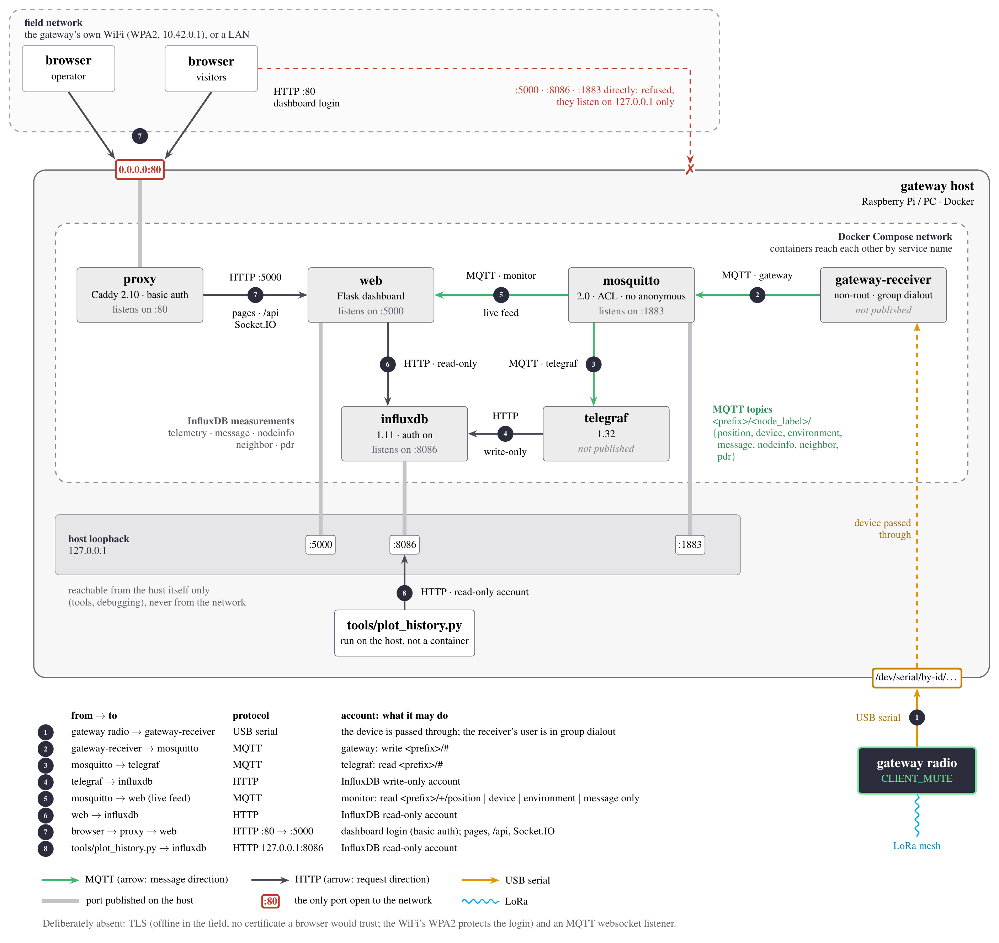

# meshtastic-gateway

[English](README.md) · **Español**

Gateway de la red mesh LoRa/Meshtastic de SASIPA en Rapa Nui. Una radio
conectada por USB escucha la malla; el gateway decodifica cada paquete, mide la
tasa de entrega de paquetes (PDR) de cada nodo frente a su cadencia de
transmisión, publica los datos por MQTT, los guarda en InfluxDB y los muestra
en un dashboard web que **funciona sin internet**.

Este documento es para el personal técnico y de TI que instala, opera y da
mantención al sistema. El detalle de diseño está en [`docs/`](docs/).

## Qué hace y qué no hace

| Hace | No hace |
|---|---|
| Recibe, decodifica y deduplica los paquetes que oye la radio gateway | **No transmite**: en Rapa Nui el gateway es solo receptor |
| Estima el PDR por nodo y por tipo de flujo (`device`, `environment`, `position`) | No configura las radios (canales, presets, cadencias) |
| Guarda todo en InfluxDB, sin política de retención (no se borra nada) | No tiene copia de respaldo ni exportación automática (ver [Datos y respaldo](#datos-y-respaldo)) |
| Muestra mapa, mensajes, gráficos y enlaces entre nodos, accesible por WiFi propia | No necesita internet para operar |

Las radios las configura el repositorio
[`meshtastic-platform`](https://github.com/OF306PUC/meshtastic-platform). Ambos
proyectos **no comparten código**: se emparejan solo a través del mismo archivo
de *deployment* ([`deployments/README.md`](deployments/README.md)).

## La red de Rapa Nui

Descrita en [`deployments/sasipa/rapa-nui.yaml`](deployments/sasipa/rapa-nui.yaml)
(modem `MEDIUM_FAST`, región `ANZ`, dos canales: telemetría y mensajería).

| Nodos | Función |
|---|---|
| N1–N6 | SenseCAP Solar Node P1 Pro del clúster de agua; N6 centraliza y retransmite hacia GW |
| GW | Radio gateway (LILYGO T-Beam), conectada por USB al computador. En `CLIENT_MUTE`: oye y nunca retransmite |
| D1, D2 | Nodos de acceso: puntos por donde una persona entra a la malla desde un teléfono o PC |
| Rx | Receptor |

> Los sensores de temperatura/humedad (SHT4X) de N1 y N3 están fuera de
> servicio; el dashboard oculta esos gráficos (`MONITOR_ENVIRONMENT_OUT_OF_SERVICE`).

## Arquitectura



Seis contenedores bajo Docker Compose:

| Servicio | Rol |
|---|---|
| `gateway-receiver` | Lee la radio por puerto serial, decodifica, deduplica, calcula PDR y publica en MQTT |
| `mosquitto` | Broker MQTT con cuentas separadas (`gateway`, `telegraf`, `monitor`) y ACL |
| `telegraf` | Lee de MQTT y escribe en InfluxDB |
| `influxdb` | Base de datos de series de tiempo (volumen `influxdb_data`) |
| `web` | Dashboard (Flask): mapa, gráfico de enlaces, mensajes, series por nodo, feed en vivo |
| `proxy` | Caddy con usuario y contraseña delante del dashboard |

**Solo el proxy (puerto 80) es accesible desde la red.** El dashboard (5000),
InfluxDB (8086) y el broker (1883) escuchan únicamente en `localhost` del host.
Es HTTP plano: sin internet no hay certificado que un navegador acepte, y el
login queda protegido por el WPA2 de la WiFi del host.

## Requisitos

- Host Linux con la radio gateway conectada por USB (probado en Raspberry Pi OS).
- Docker con **Compose v2** (`docker compose`, no `docker-compose`).
- En Raspberry Pi de 32 bits (armhf) usar `INFLUXDB_IMAGE=influxdb:1.8` en `.env`;
  la imagen 1.11 solo existe para amd64 y arm64.
- Una copia de `deployments/sasipa/rapa-nui.yaml` **idéntica byte a byte** a la
  de `meshtastic-platform`.
- Internet solo para instalar: `git pull`, bajar imágenes y construir la primera
  vez o cuando cambie `requirements.txt`.

## Instalación

```bash
cp .env.example .env          # completar las variables obligatorias (abajo)
./mqtt/init-credentials.sh    # UNA vez, antes del primer arranque; anotar la clave del dashboard
docker compose up -d --build
```

Luego abrir `http://<host>/` e ingresar con el usuario `dashboard`.

`init-credentials.sh` crea de una sola vez `mqtt/pwfile` y `secrets/<servicio>.env`
y se niega a sobrescribirlos. **Ambos deben provenir de la misma ejecución**: si
no coinciden, todos los contenedores arrancan, el dashboard carga y no llega
ningún dato (`rc=5` / `not authorised` en el log de Mosquitto).

### Variables obligatorias de `.env`

| Variable | Qué es |
|---|---|
| `MESH_DEPLOYMENT` | Archivo de `deployments/` sin `.yaml`: `sasipa/rapa-nui` |
| `MQTT_TOPIC_PREFIX` | Prefijo de los tópicos (`<prefijo>/<nodo>/<tipo>`). Sin valor por defecto; solo letras, dígitos, `.`, `_` y `-`. Tras cambiarlo: `docker compose up -d --force-recreate` |
| `GATEWAY_SERIAL_PORT` | Puerto serial de la radio. Preferir `/dev/serial/by-id/...`, porque los `ttyACM` cambian entre reinicios |
| `INFLUXDB_DB` | Nombre de la base de datos |

El resto de las variables opcionales está comentado en [`.env.example`](.env.example).
Las contraseñas **no** van en `.env` ni en git.

## Operación diaria

El host crea su propia red WiFi en cada arranque
([`docs/field-hotspot.md`](docs/field-hotspot.md)): se une a esa red desde un
notebook y abre `http://10.42.0.1/`. Los contenedores arrancan solos
(`restart: unless-stopped`); después de encender, esperar uno o dos minutos.

**Después de cada arranque, ajustar el reloj del host.** La Raspberry Pi no
tiene reloj con batería y su WiFi no tiene internet para sincronizarse, así que
arranca con la hora en que se apagó y todo lo que guarde hasta corregirla queda
con fecha en el pasado:

```bash
ssh <usuario>@10.42.0.1 "sudo date -s @$(date +%s)"   # $(date +%s) se evalúa en el notebook
```

Comandos útiles:

```bash
docker compose ps                          # los seis servicios deben estar Up
docker compose logs -f gateway-receiver    # lo que oye la radio; líneas [MSG] con el texto de los mensajes
docker compose up -d --build               # tras actualizar el código (si no, Compose reinicia la imagen vieja)
```

Al arrancar, el receptor imprime el SHA-256 del archivo de deployment y avisa
si oye remitentes desconocidos, cadencias violadas, roles distintos a los del
archivo, etc. Un `WARNING` aquí casi siempre significa que el archivo de
deployment o la configuración de una radio se desviaron
([guía](docs/troubleshooting.md#drift-warnings)).

### Dashboard

Pestañas **Map**, **Messages** y **Graph**: mapa offline (San Joaquín y Rapa Nui),
mensajes que aparecen sobre el nodo emisor en orden de llegada, y el grafo de
enlaces (hacia el gateway y entre nodos, según NeighborInfo). Cada nodo tiene
sus series de batería, canal, RSSI/SNR, saltos y, si el sensor funciona,
temperatura y humedad.

### Gráficos para informes

`tools/plot_history.py` genera series de tiempo en estilo IEEE (PNG, PDF, SVG) y
puede exportar CSV. Corre en el host, no en un contenedor:

```bash
.venv/bin/python tools/plot_history.py --days 7 --out ./figuras --format pdf
.venv/bin/python tools/plot_history.py --export datos.csv
```

## Datos y respaldo

- **Existe una sola copia**, en la tarjeta SD del host (volumen `influxdb_data`).
  Si la tarjeta falla se pierde todo lo no copiado a otro lugar.
- InfluxDB no tiene política de retención: nada se borra, así que conviene
  vigilar el espacio en disco.
- `tools/plot_history.py --export` exporta solo campos de telemetría. Una
  exportación completa para enviar por internet está **propuesta, no
  implementada**: [`docs/architecture/data-export.md`](docs/architecture/data-export.md).
- **Nunca** borrar el volumen ni usar `docker compose down -v` sin respaldar antes.

## Solución de problemas

[`docs/troubleshooting.md`](docs/troubleshooting.md) está organizado por
síntoma. La mayoría de las fallas de este sistema son **silenciosas**
(contenedores arriba, dashboard visible, cero datos). Los casos más frecuentes:

| Síntoma | Causa habitual |
|---|---|
| Todo arriba y sin datos | Credenciales: `mqtt/pwfile` y `secrets/` de ejecuciones distintas |
| Mosquitto recibe, InfluxDB vacío | Tópico o prefijo distinto entre gateway, ACL y Telegraf |
| Gateway sano pero no oye nada | Puerto serial equivocado (usar `/dev/serial/by-id/`) |
| Datos con fecha pasada | Reloj del host sin ajustar |
| `unknown shorthand flag: 'd' in -d` | Falta Docker Compose v2 |
| `no matching manifest for linux/arm/v7` | Pi de 32 bits: usar `INFLUXDB_IMAGE=influxdb:1.8` |
| Un cambio de código no tiene efecto | Compose reinició la imagen vieja: agregar `--build` |

## Estructura del repositorio

| Ruta | Contenido |
|---|---|
| `main.py`, `gateway/` | El receptor: decodificar, deduplicar, PDR, publicar |
| `monitor/` | El dashboard (`python -m monitor`) |
| `proxy/`, `mqtt/`, `telegraf/` | Login, broker/ACL/generador de credenciales, mapeo tópico → medición |
| `deployments/` | Descripción de la malla, compartida con la plataforma |
| `tools/` | Gráficos y exportación desde la base de datos |
| `tests/` | Pruebas `unittest`; no requieren radio, broker ni base de datos |
| `docs/` | Diseño, contrato de datos, solución de problemas, arquitectura |

## Desarrollo y pruebas

```bash
python3 -m venv .venv
.venv/bin/pip install -r requirements.txt -r monitor/requirements.txt -r tools/requirements.txt
.venv/bin/python -m unittest discover -s tests -t .
```

Antes de cambiar un payload, un tópico o un puerto, leer
[`docs/design.md`](docs/design.md): los nombres de campo son un contrato con
Telegraf, InfluxDB y el dashboard, y **un campo renombrado se pierde sin
ningún error**.

## Documentación

Los documentos de `docs/` están en inglés, salvo el estimador de PDR.

- [`docs/design.md`](docs/design.md) — límites con la plataforma, contrato de datos
  (campos, tópicos, mediciones), cuentas y puertos, invariantes G1–G13.
- [`docs/troubleshooting.md`](docs/troubleshooting.md) — fallas por síntoma.
- [`docs/field-hotspot.md`](docs/field-hotspot.md) — el host como punto de acceso
  WiFi; unirse temporalmente a otra red.
- [`deployments/README.md`](deployments/README.md) — el archivo de deployment y cómo
  mantenerlo idéntico al de la plataforma.
- [`docs/architecture/pdr-cadence-tracker.md`](docs/architecture/pdr-cadence-tracker.md)
  — cómo se estima el PDR (en español).
- [`docs/architecture/message-delivery.md`](docs/architecture/message-delivery.md) — qué
  puede y qué no puede confirmar el gateway sobre un mensaje.
- [`docs/architecture/data-export.md`](docs/architecture/data-export.md) — propuesta
  de exportación de datos.
- [`docs/future-work.md`](docs/future-work.md) — funciones pedidas y aún no construidas.
- [`docs/session-log.md`](docs/session-log.md) — historial de decisiones.
