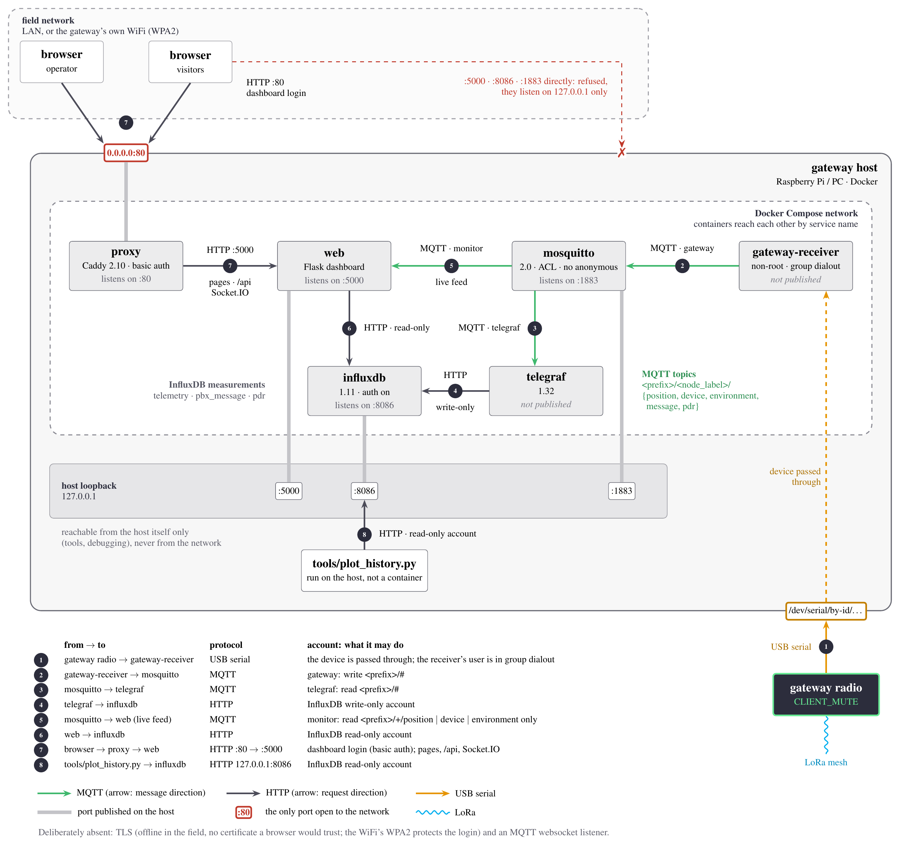

# meshtastic-gateway

Ingestion and persistence for a Meshtastic mesh. A gateway radio hears the
mesh; the gateway decodes each packet, measures each node's packet delivery
ratio (PDR) against its broadcast cadence, publishes over MQTT, stores in
InfluxDB and shows it on a dashboard that works without internet.

The radios themselves — channels, presets, cadences — are configured by
[`meshtastic-platform`](https://github.com/OF306PUC/meshtastic-platform). The
two share no code: they pair through the same deployment file
([`deployments/README.md`](deployments/README.md)).



Only the proxy (port 80, with a login) is open to the network; everything else
listens on the host's localhost. Source: `docs/diagrams/port-architecture.tex`,
rebuilt with `docs/diagrams/build.sh`.

## Quick start

On the host the gateway radio is plugged into (Docker Compose v2):

```bash
cp .env.example .env              # MQTT_TOPIC_PREFIX, MESH_DEPLOYMENT, GATEWAY_SERIAL_PORT, INFLUXDB_DB
cp <platform>/deployments/<name>.yaml deployments/   # byte-identical to the platform's copy
./mqtt/init-credentials.sh        # once, before the first start; note the dashboard password
docker compose up -d --build
```

Then open `http://<gateway-host>/` and log in as `dashboard`.

## Repository

| Path | What it is |
|---|---|
| `main.py`, `gateway/` | The receiver: decode, deduplicate, PDR, publish (`gateway-receiver` container) |
| `monitor/` | The dashboard: map, per-node charts, live feed (`web` container, `python -m monitor`) |
| `proxy/`, `mqtt/`, `telegraf/` | The login in front of the dashboard; broker config, ACL and credential generator; topic → measurement mapping |
| `docker-compose.yaml`, `Dockerfile` | The six services |
| `deployments/` | The mesh description, shared with the platform |
| `tools/plot_history.py` | IEEE-style time series from the database (PNG, PDF, SVG, CSV), run on the host |
| `tests/` | `unittest`; no radio, broker or database needed |

## Development

```bash
python3 -m venv .venv
.venv/bin/pip install -r requirements.txt -r monitor/requirements.txt -r tools/requirements.txt
.venv/bin/python -m unittest discover -s tests -t .
```

## Documentation

- [`docs/design.md`](docs/design.md) — the boundary with the platform, the
  published contract (fields, topics, measurements), accounts and ports, and
  the invariants G1–G13. Read it before changing a payload, a topic or a port.
- [`docs/troubleshooting.md`](docs/troubleshooting.md) — by symptom; nearly
  every failure here is a silent one.
- [`docs/field-hotspot.md`](docs/field-hotspot.md) — in the field the host
  makes its own WiFi; switching between it and the office network.
- [`docs/architecture/pdr-cadence-tracker.md`](docs/architecture/pdr-cadence-tracker.md)
  — how the delivery ratio is estimated (in Spanish).
- [`docs/session-log.md`](docs/session-log.md) — what was done, when, and why.
